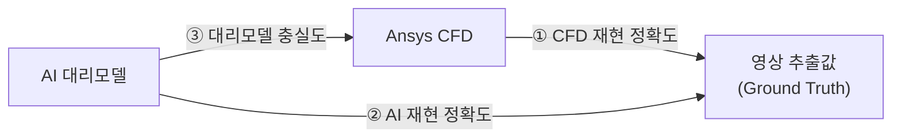
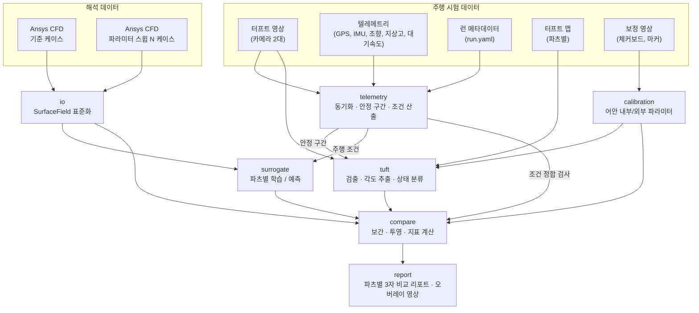
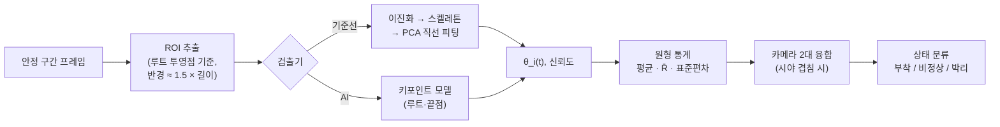

# PROJECT-VORTEX 설계 문서

> 공력장치 **터프트(tuft) 주행 테스트 영상**과 **Ansys CFD 정상 해석 결과**, 그리고 CFD로 학습한 **AI 대리모델**의 3자 비교를 통한 유동 재현 정확도 측정

| 항목 | 내용 |
| --- | --- |
| 문서 상태 | 초안 v0.2 |
| 범위 | 아키텍처, 방법론, 데이터 사양, 지표, 로드맵 (코드 없음) |
| 미결 사항 | [10. 리스크와 미결 사항](#10-리스크와-미결-사항) 참고 |

**변경 이력**
- v0.1: 최초 작성
- v0.2: 시험 구성을 확정해 반영. 대상 4개 파츠, 카메라 2대·파츠별 촬영, 정상 해석, 주행 시험. 주행 텔레메트리와 동기화 설계, 터프트 배치 가이드, CFD 내보내기·DoE 권장안 추가

---

## 1. 목표와 범위

### 1.1 목표
공력장치 표면에 털실을 붙이고 **실차 주행 중** 촬영한 영상에서 **실제 표면 유동 방향과 유동 상태**를 정량적으로 추출한다. 이 값을 기준값(ground truth)으로 삼아 다음 두 가지가 실제 유동을 얼마나 잘 재현하는지 측정한다.

- **Ansys CFD 정상(steady) 해석** 결과
- CFD 해석 결과로 학습한 **AI 대리모델(surrogate)** 의 예측

### 1.2 측정할 "재현 정확도" 세 가지



| # | 비교 | 의미 |
| --- | --- | --- |
| ① | 영상 ↔ CFD | CFD 모델링(난류모델, 메쉬, 경계조건)이 실제 유동을 얼마나 맞히는가 |
| ② | 영상 ↔ AI | AI 대리모델이 실제 유동을 얼마나 맞히는가. CFD를 돌리지 않은 주행 조건에서도 평가할 수 있다 |
| ③ | CFD ↔ AI | AI가 CFD를 얼마나 충실히 흉내 내는가. ①과 ②의 차이를 해석하는 근거가 된다 |

②의 오차는 대략 ③의 오차와 ①의 오차가 합쳐진 것이다. 그래서 세 값을 함께 봐야 오차가 어디서 왔는지 판단할 수 있다.

### 1.3 범위 밖 (초기 단계)
- 체적(volume) 유동장 비교 (PIV 등). 터프트는 표면 정보만 준다
- 공력 계수(Cl, Cd) 검증. 하중 측정 데이터가 생기면 확장한다
- 비정상(과도) 유동 비교. CFD를 정상 해석으로 진행하므로 다루지 않는다
- 실시간 처리

### 1.4 시험 구성

**전제**
- CFD: **정상 RANS** 해석
- 시험: **실차 주행** (풍동 아님)
- 카메라: **2대**. 파츠별로 따로 촬영한다

**대상 파츠**

| 파츠 ID | 파츠 | 주 관찰 면 | 특이사항 |
| --- | --- | --- | --- |
| `FW` | 프론트윙 | 윗면, 엔드플레이트 | 지면 효과가 강하다. 앞 지상고에 매우 민감하다. 흡입면(아랫면)은 시야 확보가 어렵다 |
| `RW` | 리어윙 | 윗면(압력면), 엔드플레이트, 가능하면 아랫면(흡입면) | 흡입면이 아랫면이라 카메라 배치가 어렵다. 플랩 끝 박리가 주 관찰 대상이다 |
| `SD` | 사이드 디퓨저 | 디퓨저 램프 표면 | 차체 하부라 시야와 조명 확보가 어렵다. 지상고·피치와 노면 오염에 민감하다 |
| `DUCT` | 에어덕트 인근 | 덕트 입구·출구 주변 차체 표면 | 덕트 흡입·배출 유량에 따라 국부 유동이 달라진다. 냉각 유량 조건을 맞춰야 한다 |

**운용 단위**

```
run = (파츠 1개, 카메라 1~2대, 주행 1회)
```

- 기본안: 카메라 2대가 **같은 파츠를 서로 다른 각도**에서 찍는다. 시야가 겹치는 터프트는 두 번 관측되므로 교차검증과 융합에 쓴다
- 대안: 두 카메라가 **서로 다른 파츠**를 하나씩 맡는 경우도 같은 데이터 구조로 처리한다. `run.yaml`의 카메라별 `part` 필드로 구분한다

---

## 2. 물리적 배경: 터프트가 알려주는 것

### 2.1 터프트와 벽면 전단응력
표면에 붙인 짧은 털실은 국부 **벽면 전단응력 벡터 τ_w의 방향**, 즉 표면 마찰선(skin-friction line)을 따라 정렬된다. 그래서 CFD 쪽에서 비교할 물리량은 다음과 같다.

- **τ_w 벡터 방향**: 터프트 각도와 직접 비교한다
- **τ_w 크기**: 터프트 안정성(흔들림)과 관련 있다. 신뢰도 가중치에도 쓴다
- **유동 상태**: τ_w 방향과 크기로 판정한다

### 2.2 유동 상태 정의

| 상태 | 터프트 거동 (영상) | CFD 판정 근거 (정상 해석) |
| --- | --- | --- |
| **부착 (Attached)** | 자유류 방향으로 안정적으로 정렬 | τ_w가 국부 기준방향과 45° 이내, \|τ_w\|가 임계값 이상 |
| **비정상/천이 (Unsteady)** | 크게 흔들림, 방향이 일정하지 않음 | 기준방향과 45~135°, 또는 \|τ_w\| ≈ 0 (박리 직전) |
| **박리/역류 (Separated)** | 뒤집히거나 상류를 향함, 불규칙 회전 | 기준방향과 135° 이상 (역류) |

*국부 기준방향*은 자유류 벡터를 해당 지점의 표면 접평면에 투영한 방향이다. 주행 시험에서는 요(yaw)를 반영한 상대풍 방향을 쓴다. 각도 임계값은 설정 파일로 조정할 수 있게 둔다.

### 2.3 한계와 보정 고려사항

**터프트 자체의 한계**
- **중력, 터프트 강성, 관성**: 저속이나 저전단 구간에서는 터프트가 τ_w를 잘 따르지 않는다. 이 구간은 \|τ_w\|로 가중치를 낮춘다
- **응답 지연**: 터프트는 고주파 변동을 걸러낸다. 영상에서 얻는 것은 사실상 저역통과된 방향이다
- **유동 교란**: 터프트 자체가 경계층을 교란해 박리를 앞당길 수 있다. 터프트 밀도와 길이를 기록한다
- **원근 왜곡**: 3D 표면 방향은 카메라 투영 후 각도가 바뀐다. 반드시 카메라 모델로 투영한 뒤 비교한다 ([5.6](#56-compare-비교-엔진))

**정상 해석에서 생기는 제약**
- **시간평균 비교만 가능**: 정상 RANS는 시간평균장에 해당한다. 영상도 안정 구간의 **원형평균(circular mean)** 각도로만 비교한다
- **"비정상" 상태는 근사**: 정상 해석은 흔들림을 직접 보여주지 못한다. CFD의 "비정상" 상태는 \|τ_w\|가 작거나 방향이 45~135°인 구간으로 근사한다. 이 클래스의 일치도는 해석할 때 주의한다
- **수렴 진동**: 대규모 박리 구간에서는 정상 해석 잔차가 진동하며 수렴하지 않을 수 있다. 마지막 N 반복(예: 500회)의 τ_w를 평균해 내보내고, 잔차와 모니터 값 변동을 `case.yaml`에 기록한다. 변동이 큰 영역은 신뢰도를 낮춘다

---

## 3. 전체 파이프라인



처리 흐름을 요약하면 다음과 같다.
1. 영상과 텔레메트리를 시간 동기화한다. 직선 정속 **안정 구간**을 찾고, 그 구간의 주행 조건(대기속도, 요, 지상고)을 산출한다.
2. 보정 영상으로 카메라 모델을 만든다. 차량 CAD 좌표계와 이미지 좌표계를 연결한다.
3. 영상의 안정 구간에서 터프트별 각도 시계열 `θ_i(t)`를 추출하고, 통계값과 유동 상태로 요약한다.
4. CFD 표면 데이터를 공통 구조(`SurfaceField`)로 읽어 들인다.
5. 여러 CFD 케이스로 파츠별 대리모델을 학습하고, 측정된 주행 조건에 대한 표면장을 예측한다.
6. CFD와 대리모델의 τ_w를 터프트 루트 위치에서 보간한다. 이를 이미지 평면에 투영한 뒤 영상 값과 비교한다.

---

## 4. 데이터 사양

### 4.1 CFD 표면 데이터

**해석 모델 권장사항**
- **풀카(차량 전체) 모델**을 권장한다. 파츠끼리 서로 영향을 주기 때문이다. 예를 들어 프론트윙 후류는 사이드 디퓨저와 덕트 입구 유동을 바꾼다
- **이동 지면 + 회전 휠** 경계조건. 주행 시험을 재현하려면 필수다. 특히 `FW`, `SD`는 지면 효과에 크게 의존한다
- **덕트**: 라디에이터·열교환기는 다공성 매체(porous media)로 모델링한다. 압력손실 계수를 실제 부품과 맞춘다
- 대상 파츠 표면은 국부 메쉬를 세분화한다. 벽 함수 사용 여부와 y+ 범위를 `case.yaml`에 기록한다

**내보내기 권장안** (형식 미정이므로 기본값을 제시)
- **기본**: Fluent `File > Export > Solution Data`
  - 형식: ASCII (CSV)
  - `Node Values` 체크
  - 표면: 파츠별 wall zone만 선택
  - 변수: 좌표, `wall-shear-x/y/z`, `pressure` (선택: `skin-friction-coef`, `pressure-coefficient`)
- **파츠별 wall zone 명명 규칙**: `fw_*`, `rw_*`, `sd_*`, `duct_*`. 이 접두어로 로더가 파츠를 자동 분리한다
- **전환 조건**: 법선 벡터, 면 연결성(메쉬 기반 보간이나 GNN 대리모델)이 필요해지면 EnSight Gold로 전환한다. 로더는 어댑터 구조라 형식이 바뀌어도 이후 단계는 영향을 받지 않는다
- 정상 해석 수렴이 진동하면 마지막 N 반복의 데이터 샘플링(평균) 결과를 내보낸다 ([2.3](#23-한계와-보정-고려사항))

**표면 데이터 컬럼**

| 컬럼 | 단위 | 설명 |
| --- | --- | --- |
| `x, y, z` | m | 노드 좌표 (차량 CAD 좌표계와 일치해야 함) |
| `nx, ny, nz` | – | 외향 단위 법선 (없으면 인접 점으로 추정) |
| `tau_x, tau_y, tau_z` | Pa | 벽면 전단응력 벡터 (`wall-shear-x/y/z`) |
| `p` | Pa | 정압 |
| `cp` | – | 압력계수 (선택) |
| `cf` | – | 표면 마찰계수 (선택) |
| `zone` | – | wall zone 이름 → 파츠 ID |

- **좌표계 규약**: 해석 좌표계와 CAD 좌표계가 같아야 한다. 다르면 4×4 변환행렬을 `case.yaml`에 기록한다
- **케이스 메타데이터** (`case.yaml`): 대기속도, 요, 앞뒤 지상고, 윙 각도, 밀도, 점성, 난류모델, 지면·휠 경계조건, 덕트 다공성 매체 계수, 수렴 정보

### 4.2 터프트 영상 (차량 탑재 카메라)

| 항목 | 권장 사양 |
| --- | --- |
| 카메라 | 액션캠 등 차량 탑재형. 광각·어안 렌즈는 어안 보정 모델로 처리한다 |
| 해상도 | 1920×1080 이상 (4K 권장). 터프트 한 가닥이 최소 20 px 길이로 보일 것 |
| 프레임레이트 | 60 fps 이상 |
| 셔터 | 1/1000 s 이하. 진동과 모션블러를 줄인다. 자동 노출은 셔터 우선 또는 수동 고정 |
| 마운트 | 차체에 강체 고정 (석션 마운트보다 볼트 고정 권장). 진동 공진을 피한다 |
| 롤링셔터 | 진동이 크면 프레임 내 왜곡이 생긴다. 글로벌셔터 기종이 있으면 우선 사용 |
| 대비 | 카본·검정 표면 + 형광 털실. 반사가 심한 표면은 무광 처리 |
| 조명 | 일조 각도와 그림자 변화가 크다. 같은 시간대에 반복 주행하고, 하부(`SD`)는 보조 조명을 검토한다 |
| 마커 | 파츠 주변 차체에 ArUco 마커 6개 이상 부착 (CAD 좌표 측정) |
| 기록 | 주행 전체를 연속 기록. 안정 구간은 나중에 텔레메트리로 잘라낸다 |

### 4.3 터프트 맵과 배치 가이드

**터프트 맵** (파츠별 CSV)

| 컬럼 | 설명 |
| --- | --- |
| `tuft_id` | `<파츠>-R<행>-C<열>` (예: `FW-R03-C07`) |
| `x, y, z` | 루트(고정점) 3D 좌표 [m], 차량 CAD 좌표계 |
| `length_m` | 노출 길이 |
| `part` | `FW` / `RW` / `SD` / `DUCT` |
| `element` | 파츠 내 요소 (예: main_plane, flap1, endplate) |

루트 좌표는 3D 스캐너나 CMM으로 측정하거나, CAD 위에 지정한 설계 위치를 그대로 쓴다. 설계 위치를 쓰면 실제 부착 오차(예: ±2 mm)를 불확도에 반영한다.

**배치 가이드** (털실과 배치가 자유이므로 권장안을 제시)

| 항목 | 권장값 | 이유 |
| --- | --- | --- |
| 재질 | 아크릴 또는 울 사, 직경 0.5~1 mm | 가볍고 유연해 저전단에서도 잘 따른다 |
| 색 | 형광 노랑·주황 | 카본 표면과 대비. 검출 정확도에 직결된다 |
| 길이 | `FW` 20~30 mm, `RW`·`SD`·`DUCT` 30~50 mm | 국부 코드 길이의 약 10~15%. 너무 길면 국부 방향을 평균해 버린다 |
| 간격 | 길이의 1.2~1.5배 이상 | 이웃 터프트와 겹치지 않아야 ROI 검출이 단순해진다 |
| 고정 | 루트를 얇은 테이프(알루미늄 또는 비닐)로 고정 | 테이프 두께가 유동을 덜 교란한다. 테이프 앞 가장자리는 유동 방향과 수직이 되게 붙인다 |
| 배열 | 코드 방향 × 스팬 방향 격자 | 행·열 ID를 자동 부여하고, 박리선 보간이 쉬워진다 |

**사전 CFD로 배치 결정**
- 기준 CFD 1케이스를 먼저 돌린다
- **예측 박리선과 재부착선 주변**은 조밀하게 배치한다
- 부착 구간이 확실한 영역과 저전단 영역(\|τ_w\| 작음)은 성글게 배치한다
- 카메라 시선이 표면과 거의 평행한 영역(투영 왜곡이 큰 곳)은 피한다
- 설계한 배치를 CAD에 표시하고, 그 좌표를 터프트 맵으로 바로 쓴다

### 4.4 카메라 보정
- **내부 파라미터**: ChArUco 보드로 구한다. 광각·어안 렌즈는 OpenCV `fisheye` 모델을 쓴다. 카메라 설정(해상도, 화각 모드, 손떨림 보정)은 시험과 **동일하게** 고정하고, 손떨림 보정(EIS)은 끈다
- **외부 파라미터**: 파츠 주변 ArUco 마커(CAD 좌표를 알고 있는 점) 6개 이상으로 `solvePnP`를 풀어 카메라 자세를 구한다
  - 마운트가 강체이면 런마다 정지 상태에서 한 번 구해 고정한다
  - 주행 중 진동이 있으면 **프레임별 마커 PnP**로 자세를 보정한다. 마커가 계속 보이게 배치한다
- **품질 기준**: 재투영 오차 RMS < 1.0 px (목표 0.5 px)
- **두 카메라의 시야가 겹치는 경우**: 같은 터프트를 두 번 관측하므로 카메라 간 각도 일치도를 보정 품질 검사로 쓴다

### 4.5 주행 텔레메트리와 동기화

**채널**

| 구분 | 채널 | 용도 |
| --- | --- | --- |
| 필수 | GPS 속도·위치 (10 Hz 이상) | 지면속도, 구간 위치 |
| 필수 | IMU (가속도, 요레이트) | 직선·정속 판정 |
| 필수 | 조향각 | 직선 판정 |
| 권장 | 대기속도 (피토관) | 실제 상대풍 속도 → 레이놀즈수 |
| 권장 | 기상 (풍향·풍속, 기온, 기압) | 측풍에 따른 요 추정, 공기 밀도와 점성 |
| 권장 | 앞뒤 지상고 (레이저 거리 센서) | 지상고·피치. `FW`, `SD` 비교에 결정적 |
| 선택 | 냉각수·덕트 온도, 팬 상태 | `DUCT` 유량 조건 추정 |

**영상-텔레메트리 동기화**
- 1순위: GPS 타임코드를 영상에 기록할 수 있는 카메라
- 2순위: 주행 시작 전 동기화 이벤트(LED 플래시 또는 클랩)를 두 카메라와 데이터로거에 동시에 기록한다
- 동기화 오차 목표: 50 ms 이하. 정상 상태 구간만 쓰므로 엄격하지 않아도 된다

**안정 구간 자동 추출** (초기 기준, 설정 가능)
- 속도 변동 ±3% 이내
- 조향각 ≈ 0 (±2° 이내)
- 종·횡가속도 ≈ 0 (±0.1 g 이내)
- 최소 지속 시간 5 s
- 같은 런에서 조건이 다른 안정 구간이 여러 개 나오면(예: 80 km/h, 120 km/h) 구간마다 별도의 비교 단위로 처리한다

**주행 조건 산출**
- 대기속도: 피토관 값을 우선 쓴다. 없으면 `지면속도 − 바람의 주행방향 성분`으로 추정한다
- 요: `atan(측풍 성분 / 대기속도)`. 기상 데이터와 주행 방향으로 계산한다
- 공기 밀도와 점성: 기온과 기압으로 계산한다
- 지상고: 안정 구간 평균. 센서가 없으면 정적 측정값에 공력 하중 보정을 더한 추정값을 쓰고, 불확도를 크게 잡는다

**`run.yaml` 예시**

```yaml
run_id: R2026-014
date: 2026-11-02
environment: track
track: <서킷/시험로 이름>
vehicle_config: baseline_v1       # 윙 각도 등 셋업
cameras:
  - id: CAM-A
    part: RW
    video_file: raw/video/R2026-014_CAM-A.mp4
    calibration: calib/CAM-A_rw_mount_2026-11-02.yaml
  - id: CAM-B
    part: RW                      # 같은 파츠를 다른 각도에서 (기본안)
    video_file: raw/video/R2026-014_CAM-B.mp4
    calibration: calib/CAM-B_rw_mount_2026-11-02.yaml
tuft_map: tuft_maps/RW_v1.csv
telemetry:
  file: raw/telemetry/R2026-014.csv
  sync: {method: led_flash, video_offset_s: {CAM-A: 3.214, CAM-B: 2.987}}
weather:
  air_temperature_c: 18.5
  air_pressure_pa: 101500
  wind_speed_mps: 2.1
  wind_direction_deg: 240
notes: "노면 건조, 오후 2시"
```

### 4.6 디렉터리 내 데이터 배치

```
data/
├── raw/
│   ├── cfd/<case_id>/{surface.csv, case.yaml}
│   ├── video/<run_id>_<cam>.mp4
│   ├── telemetry/<run_id>.csv
│   └── calib/<cam>_<mount>_<date>/...
├── runs/<run_id>.yaml
├── tuft_maps/<part>_v<n>.csv
├── labels/                 # CVAT export (터프트 키포인트)
└── processed/
    ├── surface/<case_id>/<part>.parquet
    ├── segments/<run_id>.parquet   # 안정 구간과 구간별 조건
    ├── tuft/<run_id>/<segment>.parquet
    └── compare/<run_id>/<segment>/ # 지표, 오버레이
```

원시 데이터는 Git에 넣지 않는다. DVC나 별도 스토리지로 버전을 관리한다.

---

## 5. 모듈 설계

제안 패키지명은 `vortex`이다. 각 모듈은 독립적으로 실행하고 테스트할 수 있게 만든다. 모든 처리는 **파츠 단위**로 진행하고, 리포트에서 합친다.

### 5.1 `io`: 데이터 입출력
- **어댑터 패턴**: `CfdReader` 인터페이스 → `FluentAsciiReader`(기본), `CfdPostCsvReader`, (전환 시) `EnsightReader`, `VtkReader`
- wall zone 접두어(`fw_`, `rw_`, `sd_`, `duct_`)로 파츠를 분리한다
- 공통 출력 구조:

```python
@dataclass
class SurfaceField:
    part: str                 # "FW" | "RW" | "SD" | "DUCT"
    points: np.ndarray        # (N, 3) [m]
    normals: np.ndarray       # (N, 3)
    tau_w: np.ndarray         # (N, 3) [Pa]
    pressure: np.ndarray      # (N,)
    faces: np.ndarray | None  # (M, k) 연결성 (EnSight/VTK일 때)
    meta: CaseMeta            # 대기속도, 요, 지상고 등
```

- 컬럼명 매핑은 설정 파일로 둔다. Fluent 버전마다 헤더 이름이 다르기 때문이다
- 로드할 때 단위, 법선 방향, NaN을 검증한다

### 5.2 `telemetry`: 주행 데이터
- 데이터로거 CSV 로더. 채널 이름 매핑은 설정 파일로 둔다
- 영상-텔레메트리 동기화 (GPS 타임코드 또는 LED 이벤트 자동 검출)
- 안정 구간 추출 ([4.5](#45-주행-텔레메트리와-동기화) 기준)
- 구간별 주행 조건 산출: 대기속도, 요, 밀도, 점성, 레이놀즈수, 앞뒤 지상고, 각 값의 불확도
- 출력: `Segment(run_id, t_start, t_end, conditions, uncertainty)`

### 5.3 `calibration`: 카메라 모델
- 핀홀/어안 내부 파라미터 추정, 외부 파라미터(고정 또는 프레임별) 추정, 저장(`yaml`), 재투영 오차 리포트
- `project(points_3d, frame=None) -> points_2d` 함수를 다른 모듈에 제공한다
- CFD 표면 메쉬를 영상 위에 겹쳐 그리는 오버레이로 정합 상태를 육안 검증한다

### 5.4 `tuft`: 영상에서 터프트 추출 (AI 비전)
터프트 루트는 고정되어 있다. 그래서 일반적인 다중 객체 추적 대신 **루트 주변 ROI 단위로 처리**한다. 터프트를 서로 연결(association)하는 문제가 사라진다. 진동이 있으면 프레임별 카메라 자세로 ROI 위치를 갱신한다.



**검출기 두 가지**
1. **기준선(classical)**: 적응형 이진화(형광색 HSV 마스크), 형태학 연산, 스켈레톤, 루트에서 끝점 방향으로 PCA 직선 피팅. 라벨 없이 바로 동작한다. AI 모델 성능 비교의 기준점이 된다
2. **AI 모델**: 루트·끝점 2점 키포인트 검출(YOLO-pose 계열) 또는 터프트 마스크 세그멘테이션(U-Net / YOLO-seg) 후 방향 추정
   - 라벨링: CVAT로 키포인트 라벨링. 초기 목표는 **파츠마다** 300~500 프레임. 다양한 유동 상태, 조명, 그림자 조건을 포함한다
   - 데이터 분할: **런 단위**로 train/val/test를 나눈다(같은 런의 프레임이 섞이면 성능이 과대평가된다)
   - 증강: 밝기·대비, 그림자 패턴, 모션블러, 노이즈, 소폭 회전. 큰 회전은 각도 라벨을 바꾸므로 각도도 함께 변환한다

**출력 (터프트별, 안정 구간별)**
- `θ_i(t)`: 이미지 평면 각도. 루트→끝점 방향, 0~360°
- 원형평균 `θ̄ = atan2(Σ sin θ, Σ cos θ)`
- 평균 합성벡터 길이 `R̄ ∈ [0, 1]`. 1에 가까울수록 안정적이다
- 원형표준편차 `σ = sqrt(-2 ln R̄)`
- 프레임별 검출 신뢰도, 가려짐/미검출 비율

**카메라 2대 융합** (같은 터프트가 두 카메라에 모두 보일 때)
- 각 카메라 관측을 3D 표면 접평면 방향으로 역투영한다
- 신뢰도로 가중 평균한다. 가중치는 검출 신뢰도와 시선-법선 각도로 정한다
- 두 관측의 차이가 크면(예: 20° 초과) 플래그를 달고 검토 대상으로 둔다

**영상 기반 상태 분류 (초기 규칙, 설정 가능)**
- 부착: `R̄ ≥ 0.85` 이고 `|θ̄ − θ_ref| < 45°`
- 박리: `|θ̄ − θ_ref| > 135°` 또는 `R̄ < 0.4`
- 비정상: 그 외

여기서 `θ_ref`는 국부 기준방향(상대풍의 접평면 투영)을 이미지에 투영한 각도다. 라벨 데이터가 쌓이면 규칙 대신 소형 분류기(시계열 특징 → 3클래스)로 대체할 수 있다.

**검출기 자체의 정확도 평가** (비교 전에 반드시 수행)
- 라벨 테스트셋 기준 각도 MAE, 검출률. 목표: MAE < 5°, 검출률 > 95%. 파츠별로 따로 보고한다
- 이 값이 이후 3자 비교의 **측정 불확도 하한**이 된다

### 5.5 `surrogate`: AI 대리모델
**목적**: 주행 조건을 넣으면 파츠 표면의 τ_w 벡터장과 Cp를 예측한다. CFD를 새로 돌리지 않고도 실제 주행에서 측정된 임의 조건에서 비교할 수 있게 해 준다.

**입력 조건** (주행 시험 기준)

| 변수 | 이유 | 범위 예시 |
| --- | --- | --- |
| 대기속도 | 레이놀즈수 | 60~160 km/h |
| 요 | 측풍 | −4° ~ +4° |
| 앞 지상고 | `FW` 지면 효과, 피치 | 정적값 ± 15 mm |
| 뒤 지상고 | `SD`, 피치 | 정적값 ± 15 mm |
| (선택) 윙 각도 | 셋업 변경 시 | 셋업 범위 |

실제 범위는 주행 텔레메트리에서 관측된 분포를 보고 정한다.

**학습 데이터: CFD 파라미터 스윕** (케이스 수가 미정이므로 권장안을 제시)
- **최소 시작 구성 (약 9케이스)**: 기준 1케이스 + 4개 변수 각각 ± 한 단계씩 바꾼 OAT(one-at-a-time) 8케이스. 민감도 파악과 기준선 모델용이다
- **권장 구성 (약 40케이스)**: 4변수 라틴 하이퍼큐브. 변수당 약 10케이스가 기준이다. 본 모델 학습용이다
- **추가 케이스 선정**: 대리모델 불확도가 크거나 실제 주행 조건이 몰린 곳에 능동학습으로 추가한다
- 실제 주행 조건이 DoE 범위 **안**에 들어오도록 범위를 정한다(외삽 방지)
- 케이스마다 메쉬가 다르면 공통 표면 샘플점 집합으로 리샘플링한다

**모델 후보 (단계적 적용)**

| 단계 | 모델 | 입력 → 출력 | 비고 |
| --- | --- | --- | --- |
| 기준선 | POD + 가우시안 프로세스 회귀 | 조건 → POD 계수 → 표면장 | 소량 데이터에 강함. 불확도 제공 |
| 본 모델 | 조건부 좌표 MLP (neural field) | (x, y, z, n, 조건) → (τ_w, Cp) | 메쉬 독립. 임의 지점 질의 가능 |
| 확장 | 표면 메쉬 GNN (MeshGraphNet 계열) | 메쉬 그래프 + 조건 → 노드별 장 | 국소 박리 구조 표현에 유리. EnSight/VTK 필요 |

**모델 구성**: **파츠별 모델**(FW, RW, SD, DUCT 각각)로 시작한다. 파츠마다 표면이 작아 학습이 빠르고, 비교도 파츠 단위로 하기 때문이다. 데이터가 쌓이면 파츠 ID 임베딩을 넣은 통합 모델로 확장한다.

**설계 포인트**
- **접평면 제약**: 예측한 τ_w에서 법선 성분을 제거해 물리적으로 일관되게 만든다
- **손실 함수**: τ_w 크기 MSE + **방향 코사인 손실**(\|τ_w\|로 가중). 터프트 비교에는 방향이 핵심이기 때문이다
- **검증**: leave-one-case-out 교차검증. 결과가 ③ 대리모델 충실도 지표가 된다
- **불확도**: GPR 분산 또는 딥 앙상블로 예측 불확도를 내고, 비교 리포트에 함께 표시한다

### 5.6 `compare`: 비교 엔진

**CFD 조건 선택**
- ① 영상↔CFD: 안정 구간 조건에 **가장 가까운 CFD 케이스**를 고른다. 조건 차이를 리포트에 표시하고, 차이가 허용 범위([7장](#7-실험-해석-조건-정합-체크리스트))를 넘으면 경고한다
- ② 영상↔AI: 대리모델을 **측정 조건 그대로** 질의한다. 조건 불일치가 없다는 점이 대리모델의 장점이다

**① 터프트 위치에서 보간**
- 각 터프트 루트 `X_i`에서 τ_w를 보간한다(최근접 노드 / 역거리 가중 / 메쉬 면 내 무게중심 보간)
- 대리모델은 `X_i`에서 직접 질의한다

**② 이미지 평면으로 투영 (기본 방식)**
- CFD 방향을 단위벡터 `t_i = τ_w / |τ_w|`로 만든다
- 루트 `X_i`와 가상 끝점 `X_i + L_i · t_i`를 카메라 모델로 투영한다
- 두 투영점을 잇는 방향이 CFD 예측 이미지 각도 `θ_i^CFD`가 된다
- 같은 방식으로 `θ_i^AI`를 구한다

> 카메라 2대를 융합한 터프트는 3D 접평면에서 비교한다. 시선이 표면과 거의 평행한 터프트(투영 각도 왜곡이 큰 경우)는 신뢰도를 낮추거나 제외한다.

**③ 상태 매칭**
- CFD/AI의 유동 상태는 [2.2](#22-유동-상태-정의)의 기준으로 판정하고, 영상 상태와 비교한다

**④ 영역 비교**
- 터프트는 성글게 분포한다. 그래서 상태 지도를 표면 UV 격자(또는 이미지)에서 보간해 연속 영역으로 만든 뒤 박리 영역을 비교한다

### 5.7 `report`: 결과 출력
- 안정 구간별, 파츠별 HTML/PDF 리포트: 지표 표, 터프트별 오차 지도, 혼동행렬
- **오버레이 영상**: 실제 터프트 위에 CFD(파랑)·AI(주황) 예측 방향 화살표를 겹친다
- 전체 요약: 파츠 4개의 지표를 한 표에 모으고, 파츠별 가중 집계를 함께 보여 준다
- 조건 간 추이: 대기속도, 요, 지상고에 따른 지표 변화 그래프
- 실험 추적: MLflow에 모델, 지표, 설정을 기록한다

---

## 6. 정확도 지표

모든 지표는 **안정 구간 × 파츠** 단위로 계산하고, 리포트에서 파츠별·전체로 집계한다.

### 6.1 방향 지표 (터프트 단위 → 집계)
각도 차이는 원형으로 계산한다: `Δθ = ((θ_a − θ_b + 180) mod 360) − 180`

| 지표 | 정의 | 비고 |
| --- | --- | --- |
| 각도 MAE | `mean(\|Δθ_i\|)` [°] | 기본 지표 |
| 가중 각도 MAE | `Σ w_i \|Δθ_i\| / Σ w_i` | `w_i`: 신뢰도 가중치 ([6.5](#65-불확도와-가중치)) |
| 코사인 유사도 | `mean(cos Δθ_i)` | 1이면 완전 일치 |
| 허용각 적중률 | `\|Δθ_i\| ≤ 10°`, `≤ 20°`인 비율 | 해석하기 쉬움 |

### 6.2 유동 상태 지표
- 정확도, **매크로 F1**(박리 클래스가 적어서 단순 정확도는 왜곡된다), Cohen's κ
- 3×3 혼동행렬. "CFD는 부착인데 실제는 박리"처럼 오류 유형을 파악한다
- 정상 해석의 "비정상" 클래스는 근사값이므로([2.3](#23-한계와-보정-고려사항)), 부착/박리 2클래스 F1도 함께 보고한다

### 6.3 박리 영역 지표
- **IoU**: 박리(+비정상) 영역의 겹침 비율 (표면 UV 격자 기준)
- **박리선 거리**: 부착/박리 경계선 사이의 평균 거리와 Hausdorff 거리 [mm]. 국부 코드 길이로 정규화한 값도 함께 기록한다
- 박리 시작 위치(코드 방향 x/c)의 오차. 리어윙 플랩, 디퓨저 램프에서 특히 중요하다

### 6.4 비정상성 지표
**현 단계에서는 적용하지 않는다.** CFD를 정상 해석으로 진행하므로 비교할 대상이 없다. 영상의 터프트 원형표준편차는 비교 지표가 아니라 **진단용**으로만 쓴다. 예를 들어 CFD는 부착인데 영상이 크게 흔들리는 영역을 찾아 표시한다. 이후 과도해석(URANS/DES)을 추가하면 다시 검토한다.

### 6.5 불확도와 가중치
비교 결과에는 측정 자체의 불확도가 섞인다. 다음 항목을 정량화해 리포트에 함께 적는다.

| 불확도 요인 | 정량화 방법 |
| --- | --- |
| 터프트 검출 오차 | 라벨 테스트셋 각도 MAE (파츠별) |
| 카메라 정합 오차 | 재투영 오차 → 투영 각도 오차로 전파 (몬테카를로) |
| 주행 중 진동 | 프레임별 자세 변동 크기 |
| 터프트 위치 오차 | 루트 좌표 측정 오차 → τ_w 보간 민감도 |
| 주행 조건 오차 | 대기속도·요·지상고 불확도 → 대리모델 민감도로 전파 |
| 터프트 물리 한계 | 저전단 구간 (`\|τ_w\| < τ_min`) |
| 투영 왜곡 | 시선과 표면 법선 사이 각도가 큰 터프트 |
| CFD 수렴 진동 | 마지막 N 반복 동안의 τ_w 방향 변동 |

신뢰도 가중치 예시: `w_i = R̄_i · s(|τ_w,i|) · cos(φ_i)` (s: 저전단 감쇠 함수, φ_i: 시선과 법선 사이 각도). 불확도보다 작은 오차 차이는 "유의하지 않음"으로 표시한다.

### 6.6 종합 재현 점수
비교 쌍(①, ②, ③)마다, 파츠마다 하나의 요약 점수를 정의한다.

```
S = w_dir · (1 − MAE_w / 90°) + w_state · F1_macro + w_sep · IoU_sep
```

- 기본 가중치: `w_dir = 0.4, w_state = 0.3, w_sep = 0.3` (설정 파일)
- 전체 점수는 파츠 점수의 가중 평균이다. 기본은 터프트 수 비례이고, 설정으로 바꿀 수 있다
- 점수는 요약용이다. 해석은 항상 개별 지표로 한다
- ③(CFD↔AI)은 영상 불확도가 없으므로 표면 전체 장에 대해 상대 L2 오차, R², 방향 MAE를 추가로 보고한다

---

## 7. 실험-해석 조건 정합 체크리스트
비교가 의미 있으려면 주행 조건과 CFD 조건이 같아야 한다. 비교 실행 전에 자동으로 검사하고, 불일치는 리포트에 경고로 남긴다.

| 항목 | 확인 내용 | 허용 오차 (초기값) | 영향 큰 파츠 |
| --- | --- | --- | --- |
| 대기속도 / 레이놀즈수 | 지면속도가 아닌 **대기속도** 기준. 기온·기압으로 밀도와 점성 보정 | ±3% | 전체 |
| 요 | 측풍에서 추정한 요 | ±1° | `RW` 엔드플레이트, `DUCT` |
| 앞뒤 지상고·피치 | 안정 구간 평균 지상고 vs CFD 지상고 | ±3 mm | `FW`, `SD` |
| 주행 상태 | 직선 정속 구간인지 (조향, 가속도) | [4.5](#45-주행-텔레메트리와-동기화) 기준 | 전체 |
| 지면·휠 | CFD 이동 지면 + 회전 휠 적용 여부 | 적용 필수 | `FW`, `SD` |
| 덕트 유량 | 라디에이터 다공성 매체 계수, 그릴·셔터 상태 | 기록 | `DUCT` |
| 형상 | 실제 차량과 CAD 차이 (테이프, 마커, 터프트, 카메라 마운트 자체) | 기록 | 전체 |
| 노면·환경 | 건조/젖음, 노면 오염, 앞차 후류 유무 | 건조, 단독 주행 | `SD`, 전체 |
| 천이 | CFD 천이모델 사용 여부 vs 실제 표면 거칠기 | 기록 | `FW`, `RW` |

**카메라 마운트 자체의 영향**: 카메라와 마운트가 관찰 대상 유동을 교란할 수 있다. 가능하면 관찰 파츠의 하류가 아닌 위치에 두고, 영향이 클 것 같으면 CFD 형상에 마운트를 포함한다.

---

## 8. 제안 디렉터리 구조와 기술 스택

### 8.1 디렉터리 구조

```
PROJECT-VORTEX/
├── README.md
├── pyproject.toml
├── configs/
│   ├── default.yaml          # 임계값, 가중치, 경로
│   ├── parts.yaml            # 파츠 정의 (ID, wall zone 접두어, 터프트 맵, 기준방향)
│   ├── cfd_columns/          # Fluent/CFD-Post 컬럼 매핑
│   ├── telemetry_channels/   # 데이터로거 채널 매핑
│   └── experiments/          # 런별 비교 설정
├── data/                     # Git 제외 (DVC)
├── docs/
│   └── DESIGN.md
├── src/vortex/
│   ├── io/                   # CFD/영상 로더, SurfaceField
│   ├── telemetry/            # 동기화, 안정 구간, 주행 조건
│   ├── calibration/          # 핀홀/어안 카메라 모델, PnP, 투영
│   ├── tuft/                 # 검출기, 원형 통계, 2카메라 융합, 상태 분류
│   ├── surrogate/            # 데이터셋, 파츠별 모델, 학습/예측
│   ├── compare/              # 보간, 투영, 지표
│   ├── report/               # 리포트, 오버레이 영상
│   └── cli.py                # vortex sync | calibrate | extract | train | compare | report
├── notebooks/                # 탐색용
└── tests/                    # 합성 데이터 기반 단위 테스트
```

### 8.2 기술 스택

| 영역 | 선택 |
| --- | --- |
| 언어 | Python 3.11+ |
| 영상/비전 | OpenCV (`aruco`, `fisheye` 포함), ultralytics (YOLO-pose/seg), scikit-image |
| 딥러닝 | PyTorch (+ PyTorch Geometric: GNN 단계) |
| CFD 데이터 | pandas/pyarrow, pyvista, meshio |
| 주행 데이터 | pandas, scipy.signal (리샘플링, 필터) |
| 수치/통계 | numpy, scipy, scikit-learn (GPR, 지표) |
| 설정 | pydantic + YAML |
| 실험 추적 | MLflow |
| 데이터 버전 | DVC |
| 라벨링 | CVAT |
| 테스트 | pytest |

### 8.3 테스트 전략: 합성 데이터
실제 데이터 없이도 파이프라인 전체를 검증할 수 있도록 **합성 데이터 생성기**를 둔다.
- 알려진 τ_w 장(예: 평판 + 인위적 박리 영역)을 만든다
- 가상 어안 카메라로 터프트를 렌더링해 합성 영상을 생성한다. 진동, 그림자, 모션블러를 넣는다
- 합성 텔레메트리(가속·정속·감속 구간)로 안정 구간 추출을 검증한다
- 파이프라인이 알려진 정답을 다시 찾아내는지 확인한다 (각도 MAE ≈ 0, IoU ≈ 1)

---

## 9. 로드맵

| 단계 | 내용 | 완료 기준 |
| --- | --- | --- |
| **P0. 데이터 기반** | ① 기준 CFD 1케이스 해석 ② CFD 결과로 터프트 배치 설계 ③ 카메라 마운트·보정 ④ **파일럿 주행**: 파츠 1개(예: `RW`)로 촬영·텔레메트리·동기화 검증 | 재투영 오차 < 1 px, 동기화 오차 < 50 ms, 안정 구간 확보, CFD 메쉬 오버레이가 영상과 육안으로 일치 |
| **P1. 영상 추출** | 기준선 검출기 → 라벨링 → AI 키포인트 모델 → 2카메라 융합 | 파츠별 테스트셋 각도 MAE < 5°, 검출률 > 95% |
| **P2. CFD↔영상 비교** | 보간, 투영, 지표, 리포트 v1. 이후 4개 파츠로 확대 | 파츠별 ① 지표와 오버레이 영상 생성 |
| **P3. 대리모델** | OAT 9케이스로 POD+GPR 기준선 → LHS 약 40케이스로 neural field | leave-one-out 방향 MAE와 상대 L2 오차 보고 |
| **P4. 3자 비교** | ②, ③ 지표, 종합 점수, 여러 런·조건 추이 리포트 | 전체 런·파츠에 대한 3자 비교 리포트 자동 생성 |
| **P5. 확장** | EnSight/VTK 어댑터, GNN, 통합 대리모델, 과도해석 비정상성 비교 | 선택 |

P0와 P1은 병행할 수 있다. 합성 데이터 생성기(8.3)는 P0에서 먼저 만들어 이후 모든 단계의 회귀 테스트에 쓴다. 파일럿 주행은 시야·조명이 가장 쉬운 파츠로 시작하고, 하부(`SD`)는 마지막에 한다.

---

## 10. 리스크와 미결 사항

### 10.1 결정된 사항

| 항목 | 결정 |
| --- | --- |
| 대상 파츠 | 프론트윙, 리어윙, 사이드 디퓨저, 에어덕트 인근 |
| 카메라 | 2대, 파츠별로 따로 촬영 |
| 해석 종류 | 정상 RANS |
| 시험 환경 | 실차 주행 |
| 털실·배치 | 자유 → [4.3](#43-터프트-맵과-배치-가이드) 권장안 적용 |

### 10.2 미결 사항 (확인 필요)
- [ ] Ansys 내보내기 형식 → 확정 전까지 Fluent ASCII 기본안([4.1](#41-cfd-표면-데이터))
- [ ] 해석 케이스 수와 변수 범위 → 확정 전까지 OAT 9 / LHS 40 권장안([5.5](#55-surrogate-ai-대리모델))
- [ ] 두 카메라가 같은 파츠를 동시에 찍는지, 파츠를 나눠 찍는지
- [ ] 카메라 기종(어안 여부, 글로벌셔터 여부, GPS 타임코드 지원)과 마운트 위치
- [ ] 대기속도(피토관), 지상고 센서 확보 가능 여부
- [ ] 데이터로거 기종과 채널 목록
- [ ] 난류모델, 지면·휠 경계조건, 덕트 모델링 방식
- [ ] 시험 장소(서킷/시험로)와 일정
- [ ] 영상 라벨링 인력과 일정

### 10.3 리스크와 대응

| 리스크 | 영향 | 대응 |
| --- | --- | --- |
| 주행 조건 변동 (바람, 속도, 지상고) | CFD 조건과 불일치 | 텔레메트리 기반 안정 구간 추출, 대리모델로 측정 조건 직접 질의 |
| 대기속도·지상고 미계측 | 레이놀즈수·요·지상고 불확도 증가 | 기상 데이터로 추정, 불확도 전파, 센서 확보 우선 추진 |
| 하부·흡입면 시야 확보 어려움 (`SD`, 윙 아랫면) | 관측 터프트 부족 | 저프로파일 마운트, 보조 조명, 거울 활용 검토, 관측 가능한 면 우선 |
| 주행 진동 | 정합 오차, 모션블러 | 강체 마운트, 고속 셔터, 프레임별 마커 PnP |
| 일조·그림자 변화 | 검출 실패 | 같은 시간대 반복 주행, 형광 털실, 그림자 증강 학습 |
| 노면 오염·우천 | 하부 터프트 오염, 카메라 렌즈 오염 | 건조 노면에서만 시험, 런 전 렌즈 점검 |
| 정상 RANS의 박리 예측 한계 | ① 오차 증가 | 수렴 진동 기록, 2클래스 지표 병행, 필요 시 과도해석 추가 |
| CFD 케이스 수 부족 | 대리모델 성능 저하 | POD+GPR 기준선 유지, 능동학습으로 추가 케이스 선정 |
| 카메라 마운트의 유동 교란 | 관찰 유동 왜곡 | 하류 회피 배치, CFD 형상에 마운트 포함 |
| 대리모델 외삽 | 실제 조건에서 예측 불량 | DoE 범위 검사, 범위 밖 조건은 경고 |

---

## 부록 A. 용어

| 용어 | 설명 |
| --- | --- |
| 터프트 (tuft) | 표면 유동 방향을 보기 위해 붙이는 짧은 털실 |
| 벽면 전단응력 (τ_w) | 유체가 벽면에 작용하는 접선 방향 응력. 방향이 표면 마찰선이다 |
| 정상 RANS | 시간평균 유동을 구하는 정상 상태 난류 해석 |
| 대리모델 (surrogate) | 고비용 해석(CFD)을 근사하는 빠른 예측 모델 |
| 원형 통계 | 각도처럼 주기적인 값을 다루는 통계 (0°와 360°를 같은 값으로 처리) |
| R̄ | 평균 합성벡터 길이. 각도가 얼마나 한 방향으로 모여 있는지 나타낸다 |
| 안정 구간 | 주행 중 속도·조향·가속도가 일정하게 유지된 시간 구간 |
| 대기속도 | 차량에 대한 공기의 상대속도. 바람이 있으면 지면속도와 다르다 |
| DoE / OAT / LHS | 실험계획법 / 한 번에 한 변수씩 변경 / 라틴 하이퍼큐브 샘플링 |
| PnP | Perspective-n-Point. 3D-2D 대응점으로 카메라 자세를 구하는 문제 |
