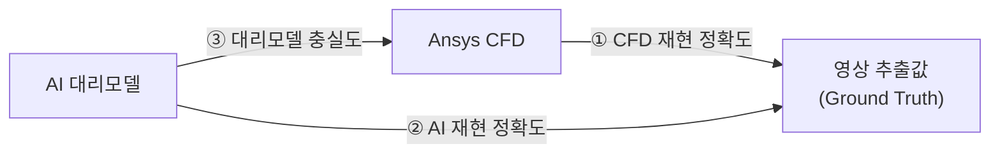
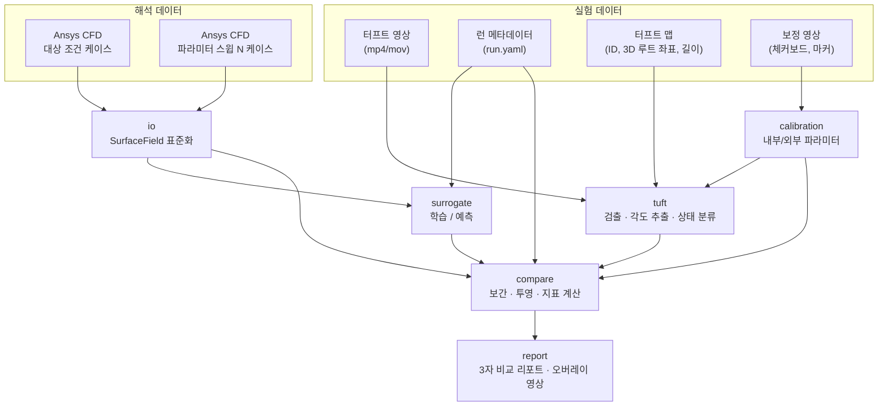
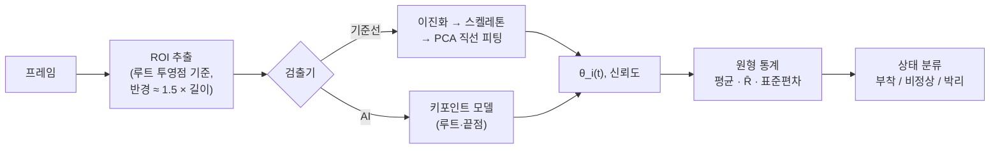

# PROJECT-VORTEX 설계 문서

> 공력장치 **터프트(tuft) 테스트 영상**과 **Ansys CFD 해석 결과**, 그리고 CFD로 학습한 **AI 대리모델**의 3자 비교를 통한 유동 재현 정확도 측정

| 항목 | 내용 |
| --- | --- |
| 문서 상태 | 초안 v0.1 |
| 범위 | 아키텍처, 방법론, 데이터 사양, 지표, 로드맵 (코드 없음) |
| 미결 사항 | [10. 리스크와 미결 사항](#10-리스크와-미결-사항) 참고 |

---

## 1. 목표와 범위

### 1.1 목표
공력장치(윙, 디퓨저, 스포일러 등) 표면에 털실을 붙이고 촬영한 영상에서 **실제 표면 유동 방향과 유동 상태**를 정량적으로 추출한다. 이 값을 기준값(ground truth)으로 삼아 다음 두 가지가 실제 유동을 얼마나 잘 재현하는지 측정한다.

- **Ansys CFD** (Fluent/CFX) 해석 결과
- CFD 해석 결과로 학습한 **AI 대리모델(surrogate)** 의 예측

### 1.2 측정할 "재현 정확도" 세 가지



| # | 비교 | 의미 |
| --- | --- | --- |
| ① | 영상 ↔ CFD | CFD 모델링(난류모델, 메쉬, 경계조건)이 실제 유동을 얼마나 맞히는가 |
| ② | 영상 ↔ AI | AI 대리모델이 실제 유동을 얼마나 맞히는가. CFD를 돌리지 않은 조건에서도 평가할 수 있다 |
| ③ | CFD ↔ AI | AI가 CFD를 얼마나 충실히 흉내 내는가. ①과 ②의 차이를 해석하는 근거가 된다 |

②의 오차는 대략 ③의 오차와 ①의 오차가 합쳐진 것이다. 그래서 세 값을 함께 봐야 오차가 어디서 왔는지 판단할 수 있다.

### 1.3 범위 밖 (초기 단계)
- 체적(volume) 유동장 비교 (PIV 등). 터프트는 표면 정보만 준다
- 공력 계수(Cl, Cd) 검증. 저울(balance) 데이터가 생기면 확장한다
- 실시간 처리

---

## 2. 물리적 배경: 터프트가 알려주는 것

### 2.1 터프트와 벽면 전단응력
표면에 붙인 짧은 털실은 국부 **벽면 전단응력 벡터 τ_w의 방향**, 즉 표면 마찰선(skin-friction line)을 따라 정렬된다. 그래서 CFD 쪽에서 비교할 물리량은 다음과 같다.

- **τ_w 벡터 방향**: 터프트 각도와 직접 비교한다
- **τ_w 크기**: 터프트 안정성(흔들림)과 관련 있다. 신뢰도 가중치에도 쓴다
- **유동 상태**: τ_w 방향과 크기로 판정한다

### 2.2 유동 상태 정의

| 상태 | 터프트 거동 (영상) | CFD 판정 근거 |
| --- | --- | --- |
| **부착 (Attached)** | 자유류 방향으로 안정적으로 정렬 | τ_w가 국부 기준방향과 45° 이내, \|τ_w\|가 임계값 이상 |
| **비정상/천이 (Unsteady)** | 크게 흔들림, 방향이 일정하지 않음 | 기준방향과 45~135°, 또는 \|τ_w\| ≈ 0 (박리 직전) |
| **박리/역류 (Separated)** | 뒤집히거나 상류를 향함, 불규칙 회전 | 기준방향과 135° 이상 (역류) |

*국부 기준방향*은 자유류 벡터를 해당 지점의 표면 접평면에 투영한 방향이다. 각도 임계값은 설정 파일로 조정할 수 있게 둔다.

### 2.3 한계와 보정 고려사항
- **중력, 터프트 강성, 관성**: 저속이나 저전단 구간에서는 터프트가 τ_w를 잘 따르지 않는다. 이 구간은 \|τ_w\|로 가중치를 낮춘다
- **응답 지연**: 터프트는 고주파 변동을 걸러낸다. 영상에서 얻는 것은 사실상 저역통과된 방향이다
- **유동 교란**: 터프트 자체가 경계층을 교란해 박리를 앞당길 수 있다. 터프트 밀도와 길이를 기록한다
- **정상해와 시간평균 비교**: RANS 정상해는 시간평균장이다. 따라서 영상도 **원형평균(circular mean)** 각도로 비교한다. 비정상성 비교는 URANS/DES 과도해석이 있을 때만 한다
- **원근 왜곡**: 3D 표면 방향은 카메라 투영 후 각도가 바뀐다. 반드시 카메라 모델로 투영한 뒤 비교한다 ([5.5](#55-compare-비교-엔진))

---

## 3. 전체 파이프라인



처리 흐름을 요약하면 다음과 같다.
1. 보정 영상으로 카메라 모델을 만든다. 장치 CAD 좌표계와 이미지 좌표계를 연결한다.
2. 영상에서 터프트별 각도 시계열 `θ_i(t)`를 추출하고 통계값과 유동 상태로 요약한다.
3. CFD 표면 데이터를 공통 구조(`SurfaceField`)로 읽어 들인다.
4. 여러 CFD 케이스로 대리모델을 학습하고, 실험 조건에 대한 표면장을 예측한다.
5. CFD와 대리모델의 τ_w를 터프트 루트 위치에서 보간한다. 이를 이미지 평면에 투영한 뒤 영상 값과 비교한다.

---

## 4. 데이터 사양

### 4.1 CFD 표면 데이터
**1단계 형식**: Fluent의 `File > Export > Solution Data` (ASCII/CSV) 또는 CFD-Post의 표면 export. 대상은 장치 표면 zone만이다.

| 컬럼 | 단위 | 설명 |
| --- | --- | --- |
| `x, y, z` | m | 노드 또는 면 중심 좌표 (CAD 좌표계와 일치해야 함) |
| `nx, ny, nz` | – | 외향 단위 법선 (없으면 메쉬에서 계산) |
| `tau_x, tau_y, tau_z` | Pa | 벽면 전단응력 벡터 (`wall-shear-x/y/z`) |
| `p` | Pa | 정압 |
| `cp` | – | 압력계수 (선택) |
| `cf` | – | 표면 마찰계수 (선택) |

- **좌표계 규약**: 해석 좌표계와 CAD 좌표계가 같아야 한다. 다르면 4×4 변환행렬을 `case.yaml`에 기록한다
- **케이스 메타데이터** (`case.yaml`): 자유류 속도, 장치 각도, 요(yaw), 밀도, 점성, 난류모델, 정상/과도 여부, 메쉬 정보
- **2단계 형식**: EnSight Gold / VTK 어댑터를 추가한다(`pyvista`, `meshio`). 메쉬 연결성을 활용한 보간과 GNN 대리모델에 필요하다
- **과도해석**: 시간 스텝별 파일 또는 시간평균 τ_w, 그리고 RMS 출력

### 4.2 터프트 영상
| 항목 | 권장 사양 |
| --- | --- |
| 해상도 | 1920×1080 이상. 터프트 한 가닥이 최소 20 px 길이로 보일 것 |
| 프레임레이트 | 60 fps 이상 (비정상성 분석 시 120 fps 이상) |
| 셔터 | 1/1000 s 이하. 모션블러 최소화 |
| 카메라 | 삼각대 또는 차량 고정. 런 중 카메라 이동 금지 |
| 대비 | 장치 표면과 털실 색이 뚜렷이 대비될 것 (예: 검은 표면 + 형광 털실) |
| 기록 길이 | 정상 상태 구간 최소 10 s |

**런 메타데이터** (`run.yaml`) 예시:

```yaml
run_id: R2026-001
date: 2026-10-10
environment: wind_tunnel        # wind_tunnel | track
freestream_speed_mps: 30.0
device_angle_deg: 12.0
yaw_deg: 0.0
air_temperature_c: 22.5
air_pressure_pa: 101200
camera_id: CAM-A
video_file: raw/video/R2026-001_CAM-A.mp4
steady_window_s: [5.0, 20.0]    # 통계 계산에 쓸 구간
tuft_map: tuft_maps/wing_v1.csv
calibration: calib/CAM-A_2026-10-10.yaml
```

### 4.3 터프트 맵
각 터프트의 위치를 CAD 좌표계로 정의한다. 3D 스캐너나 CMM으로 측정하거나, CAD 위에 설계 위치를 지정한다.

| 컬럼 | 설명 |
| --- | --- |
| `tuft_id` | 고유 ID (예: `W-R03-C07`, 행/열 규칙) |
| `x, y, z` | 루트(고정점) 3D 좌표 [m] |
| `length_m` | 노출 길이 |
| `zone` | 장치 내 영역 (예: main_plane, flap, endplate) |

### 4.4 카메라 보정
- **내부 파라미터**: 체커보드 또는 ChArUco 보드로 초점거리, 주점, 왜곡계수를 구한다 (OpenCV `calibrateCamera`)
- **외부 파라미터**: 장치에 붙인 ArUco 마커나 기준점(CAD 좌표를 알고 있는 점) 6개 이상으로 `solvePnP`를 풀어 카메라 자세를 구한다
- **품질 기준**: 재투영 오차 RMS < 1.0 px (목표 0.5 px)
- 런마다 카메라가 바뀌면 외부 파라미터를 다시 구한다. 마커가 영상에 계속 보이면 프레임별 자세 추정도 가능하다(주행 시험)

### 4.5 디렉터리 내 데이터 배치

```
data/
├── raw/
│   ├── cfd/<case_id>/{surface.csv, case.yaml}
│   ├── video/<run_id>_<cam>.mp4
│   └── calib/<cam>_<date>/...
├── tuft_maps/<device>_v<n>.csv
├── labels/                 # CVAT export (터프트 키포인트/마스크)
└── processed/
    ├── surface/<case_id>.parquet
    ├── tuft/<run_id>.parquet   # θ_i(t), 통계, 상태
    └── compare/<run_id>/       # 지표, 오버레이
```

원시 데이터는 Git에 넣지 않는다. DVC나 별도 스토리지로 버전을 관리한다.

---

## 5. 모듈 설계

제안 패키지명은 `vortex`이다. 각 모듈은 독립적으로 실행하고 테스트할 수 있게 만든다.

### 5.1 `io`: 데이터 입출력
- **어댑터 패턴**: `CfdReader` 인터페이스 → `FluentCsvReader`, `CfdPostCsvReader`, (2단계) `EnsightReader`, `VtkReader`
- 공통 출력 구조:

```python
@dataclass
class SurfaceField:
    points: np.ndarray        # (N, 3) [m]
    normals: np.ndarray       # (N, 3)
    tau_w: np.ndarray         # (N, 3) [Pa]
    pressure: np.ndarray      # (N,)
    faces: np.ndarray | None  # (M, k) 연결성 (있을 때)
    meta: CaseMeta            # 속도, 각도, 요 등
```

- 컬럼명 매핑은 설정 파일로 둔다. Fluent 버전마다 헤더 이름이 다르기 때문이다
- 로드할 때 단위, 법선 방향, NaN을 검증한다

### 5.2 `calibration`: 카메라 모델
- 내부/외부 파라미터 추정, 저장(`yaml`), 재투영 오차 리포트
- `project(points_3d) -> points_2d` 함수를 다른 모듈에 제공한다
- CFD 표면 메쉬를 영상 위에 겹쳐 그리는 오버레이로 정합 상태를 육안 검증한다

### 5.3 `tuft`: 영상에서 터프트 추출 (AI 비전)
터프트 루트는 고정되어 있다. 그래서 일반적인 다중 객체 추적 대신 **루트 주변 ROI 단위로 처리**한다. 터프트를 서로 연결(association)하는 문제가 사라진다.



**검출기 두 가지**
1. **기준선(classical)**: 적응형 이진화, 형태학 연산, 스켈레톤, 루트에서 끝점 방향으로 PCA 직선 피팅. 라벨 없이 바로 동작한다. AI 모델 성능 비교의 기준점이 된다
2. **AI 모델**: 루트·끝점 2점 키포인트 검출(YOLO-pose 계열) 또는 터프트 마스크 세그멘테이션(U-Net / YOLO-seg) 후 방향 추정
   - 라벨링: CVAT로 키포인트 라벨링. 초기 목표는 300~500 프레임, 다양한 유동 상태 포함
   - 데이터 분할: **런 단위**로 train/val/test를 나눈다(같은 런의 프레임이 섞이면 성능이 과대평가된다)
   - 증강: 밝기·대비, 모션블러, 노이즈, 소폭 회전. 큰 회전은 각도 라벨을 바꾸므로 각도도 함께 변환한다

**출력 (터프트별)**
- `θ_i(t)`: 이미지 평면 각도. 루트→끝점 방향, 0~360°
- 원형평균 `θ̄ = atan2(Σ sin θ, Σ cos θ)`
- 평균 합성벡터 길이 `R̄ ∈ [0, 1]`. 1에 가까울수록 안정적이다
- 원형표준편차 `σ = sqrt(-2 ln R̄)`
- 프레임별 검출 신뢰도, 가려짐/미검출 비율

**영상 기반 상태 분류 (초기 규칙, 설정 가능)**
- 부착: `R̄ ≥ 0.85` 이고 `|θ̄ − θ_ref| < 45°`
- 박리: `|θ̄ − θ_ref| > 135°` 또는 `R̄ < 0.4`
- 비정상: 그 외

여기서 `θ_ref`는 국부 기준방향(자유류의 접평면 투영)을 이미지에 투영한 각도다. 라벨 데이터가 쌓이면 규칙 대신 소형 분류기(시계열 특징 → 3클래스)로 대체할 수 있다.

**검출기 자체의 정확도 평가** (비교 전에 반드시 수행)
- 라벨 테스트셋 기준 각도 MAE, 검출률. 목표: MAE < 5°, 검출률 > 95%
- 이 값이 이후 3자 비교의 **측정 불확도 하한**이 된다

### 5.4 `surrogate`: AI 대리모델
**목적**: 운전 조건(속도, 장치 각도, 요 등)을 넣으면 장치 표면의 τ_w 벡터장과 Cp를 예측한다. CFD를 새로 돌리지 않고도 임의 실험 조건에서 비교할 수 있게 해 준다.

**학습 데이터**: CFD 파라미터 스윕
- 실험계획(DoE): 라틴 하이퍼큐브 또는 격자. 초기 20~50 케이스
- 실험 조건이 DoE 범위 **안**에 들어오도록 범위를 정한다(외삽 방지)
- 케이스마다 메쉬가 다르면 공통 표면 샘플점 집합으로 리샘플링한다

**모델 후보 (단계적 적용)**

| 단계 | 모델 | 입력 → 출력 | 비고 |
| --- | --- | --- | --- |
| 기준선 | POD + 가우시안 프로세스 회귀 | 조건 → POD 계수 → 표면장 | 소량 데이터에 강함. 불확도 제공 |
| 본 모델 | 조건부 좌표 MLP (neural field) | (x, y, z, n, 조건) → (τ_w, Cp) | 메쉬 독립. 임의 지점 질의 가능 |
| 확장 | 표면 메쉬 GNN (MeshGraphNet 계열) | 메쉬 그래프 + 조건 → 노드별 장 | 국소 박리 구조 표현에 유리 |

**설계 포인트**
- **접평면 제약**: 예측한 τ_w에서 법선 성분을 제거해 물리적으로 일관되게 만든다
- **손실 함수**: τ_w 크기 MSE + **방향 코사인 손실**(|τ_w|로 가중). 터프트 비교에는 방향이 핵심이기 때문이다
- **검증**: leave-one-case-out 교차검증. 결과가 ③ 대리모델 충실도 지표가 된다
- **불확도**: GPR 분산 또는 딥 앙상블로 예측 불확도를 내고, 비교 리포트에 함께 표시한다

### 5.5 `compare`: 비교 엔진

**① 터프트 위치에서 보간**
- 각 터프트 루트 `X_i`에서 τ_w를 보간한다(최근접 면 / 역거리 가중 / 메쉬 면 내 무게중심 보간)
- 대리모델은 `X_i`에서 직접 질의한다

**② 이미지 평면으로 투영 (기본 방식)**
- CFD 방향을 단위벡터 `t_i = τ_w / |τ_w|`로 만든다
- 루트 `X_i`와 가상 끝점 `X_i + L_i · t_i`를 카메라 모델로 투영한다
- 두 투영점을 잇는 방향이 CFD 예측 이미지 각도 `θ_i^CFD`가 된다
- 같은 방식으로 `θ_i^AI`를 구한다

> 확장안: 영상 터프트 방향을 표면 접평면으로 역투영해 3D 공간에서 비교한다. 카메라 시선이 표면과 거의 평행한 터프트(투영 각도 왜곡이 큰 경우)는 신뢰도를 낮추거나 제외한다.

**③ 상태 매칭**
- CFD/AI의 유동 상태는 [2.2](#22-유동-상태-정의)의 기준으로 판정하고, 영상 상태와 비교한다

**④ 영역 비교**
- 터프트는 성글게 분포한다. 그래서 상태 지도를 표면 UV 격자(또는 이미지)에서 보간해 연속 영역으로 만든 뒤 박리 영역을 비교한다

### 5.6 `report`: 결과 출력
- 런별 HTML/PDF 리포트: 지표 표, 터프트별 오차 지도, 혼동행렬
- **오버레이 영상**: 실제 터프트 위에 CFD(파랑)·AI(주황) 예측 방향 화살표를 겹친다
- 케이스 간 추이: 조건(속도, 각도)에 따른 지표 변화 그래프
- 실험 추적: MLflow에 모델, 지표, 설정을 기록한다

---

## 6. 정확도 지표

### 6.1 방향 지표 (터프트 단위 → 집계)
각도 차이는 원형으로 계산한다: `Δθ = ((θ_a − θ_b + 180) mod 360) − 180`

| 지표 | 정의 | 비고 |
| --- | --- | --- |
| 각도 MAE | `mean(\|Δθ_i\|)` [°] | 기본 지표 |
| 가중 각도 MAE | `Σ w_i \|Δθ_i\| / Σ w_i` | `w_i`: 신뢰도 가중치 ([6.5](#65-불확도와-가중치)) |
| 코사인 유사도 | `mean(cos Δθ_i)` | 1이면 완전 일치 |
| 허용각 적중률 | `\|Δθ_i\| ≤ 10°`, `≤ 20°`인 비율 | 해석하기 쉬움 |

### 6.2 유동 상태 지표
- 정확도, **매크로 F1**(박리 클래스가 적어서 단순 정확도는 왜곡된다), Cohen's κ
- 3×3 혼동행렬. "CFD는 부착인데 실제는 박리"처럼 오류 유형을 파악한다

### 6.3 박리 영역 지표
- **IoU**: 박리(+비정상) 영역의 겹침 비율 (표면 UV 격자 기준)
- **박리선 거리**: 부착/박리 경계선 사이의 평균 거리와 Hausdorff 거리 [mm]. 코드 길이로 정규화한 값도 함께 기록한다
- 박리 시작 위치(코드 방향 x/c)의 오차

### 6.4 비정상성 지표 (선택, 과도해석이 있을 때)
- 터프트별 영상 원형표준편차와 CFD τ_w 방향 변동의 상관계수
- 주파수 비교는 터프트 응답 특성 때문에 정성적 참고로만 사용한다

### 6.5 불확도와 가중치
비교 결과에는 측정 자체의 불확도가 섞인다. 다음 항목을 정량화해 리포트에 함께 적는다.

| 불확도 요인 | 정량화 방법 |
| --- | --- |
| 터프트 검출 오차 | 라벨 테스트셋 각도 MAE |
| 카메라 정합 오차 | 재투영 오차 → 투영 각도 오차로 전파 (몬테카를로) |
| 터프트 위치 오차 | 루트 좌표 측정 오차 → τ_w 보간 민감도 |
| 터프트 물리 한계 | 저전단 구간 (`\|τ_w\| < τ_min`) |
| 투영 왜곡 | 시선과 표면 법선 사이 각도가 큰 터프트 |

신뢰도 가중치 예시: `w_i = R̄_i · s(|τ_w,i|) · cos(φ_i)` (s: 저전단 감쇠 함수, φ_i: 시선과 법선 사이 각도). 불확도보다 작은 오차 차이는 "유의하지 않음"으로 표시한다.

### 6.6 종합 재현 점수
비교 쌍(①, ②, ③)마다 하나의 요약 점수를 정의한다.

```
S = w_dir · (1 − MAE_w / 90°) + w_state · F1_macro + w_sep · IoU_sep
```

- 기본 가중치: `w_dir = 0.4, w_state = 0.3, w_sep = 0.3` (설정 파일)
- 점수는 요약용이다. 해석은 항상 개별 지표로 한다
- ③(CFD↔AI)은 영상 불확도가 없으므로 표면 전체 장에 대해 상대 L2 오차, R², 방향 MAE를 추가로 보고한다

---

## 7. 실험-해석 조건 정합 체크리스트
비교가 의미 있으려면 실험 조건과 CFD 조건이 같아야 한다. 비교 실행 전에 자동으로 검사하고, 불일치는 리포트에 경고로 남긴다.

| 항목 | 확인 내용 | 허용 오차 (초기값) |
| --- | --- | --- |
| 자유류 속도 / 레이놀즈수 | 실측 온도·압력으로 밀도와 점성 보정 | ±3% |
| 장치 각도 | 실측 각도와 CAD 각도 | ±0.5° |
| 요 각도 | 풍동 턴테이블 / 주행 시 측풍 | ±1° |
| 지면 효과 | 풍동 이동지면 유무, 지상고 | 일치 여부 |
| 형상 | 실제 장치와 CAD (테이프, 마커, 터프트 부착 영향) | 기록 |
| 난류 강도 | 풍동 사양 vs CFD 입구 조건 | 기록 |
| 천이 | CFD 천이모델 사용 여부 vs 실제 표면 거칠기 | 기록 |

주행 시험은 조건 변동이 크다. 그래서 차량 속도와 측풍 데이터를 함께 기록하고, 조건이 안정된 구간만 통계에 사용한다.

---

## 8. 제안 디렉터리 구조와 기술 스택

### 8.1 디렉터리 구조

```
PROJECT-VORTEX/
├── README.md
├── pyproject.toml
├── configs/
│   ├── default.yaml          # 임계값, 가중치, 경로
│   ├── cfd_columns/          # Fluent/CFD-Post 컬럼 매핑
│   └── experiments/          # 런별 비교 설정
├── data/                     # Git 제외 (DVC)
├── docs/
│   └── DESIGN.md
├── src/vortex/
│   ├── io/                   # CFD/영상 로더, SurfaceField
│   ├── calibration/          # 카메라 모델, PnP, 투영
│   ├── tuft/                 # 검출기, 원형 통계, 상태 분류
│   ├── surrogate/            # 데이터셋, 모델, 학습/예측
│   ├── compare/              # 보간, 투영, 지표
│   ├── report/               # 리포트, 오버레이 영상
│   └── cli.py                # vortex calibrate | extract | train | compare | report
├── notebooks/                # 탐색용
└── tests/                    # 합성 데이터 기반 단위 테스트
```

### 8.2 기술 스택

| 영역 | 선택 |
| --- | --- |
| 언어 | Python 3.11+ |
| 영상/비전 | OpenCV, ultralytics (YOLO-pose/seg), scikit-image |
| 딥러닝 | PyTorch (+ PyTorch Geometric: GNN 단계) |
| CFD 데이터 | pandas/pyarrow, pyvista, meshio |
| 수치/통계 | numpy, scipy, scikit-learn (GPR, 지표) |
| 설정 | pydantic + YAML |
| 실험 추적 | MLflow |
| 데이터 버전 | DVC |
| 라벨링 | CVAT |
| 테스트 | pytest |

### 8.3 테스트 전략: 합성 데이터
실제 데이터 없이도 파이프라인 전체를 검증할 수 있도록 **합성 데이터 생성기**를 둔다.
- 알려진 τ_w 장(예: 평판 + 인위적 박리 영역)을 만든다
- 가상 카메라로 터프트를 렌더링해 합성 영상을 생성한다
- 파이프라인이 알려진 정답을 다시 찾아내는지 확인한다 (각도 MAE ≈ 0, IoU ≈ 1)

---

## 9. 로드맵

| 단계 | 내용 | 완료 기준 |
| --- | --- | --- |
| **P0. 데이터 기반** | 데이터 사양 확정, 단일 런(영상 1개 + CFD 1케이스) 확보, 터프트 맵과 카메라 보정 | 재투영 오차 < 1 px, CFD 메쉬 오버레이가 영상과 육안으로 일치 |
| **P1. 영상 추출** | 기준선 검출기 → 라벨링 → AI 키포인트 모델 | 테스트셋 각도 MAE < 5°, 검출률 > 95% |
| **P2. CFD↔영상 비교** | 보간, 투영, 지표, 리포트 v1 | 단일 런 ① 지표와 오버레이 영상 생성 |
| **P3. 대리모델** | DoE 스윕 CFD 확보, POD+GPR → neural field | leave-one-out 방향 MAE와 상대 L2 오차 보고 |
| **P4. 3자 비교** | ②, ③ 지표, 종합 점수, 여러 런 추이 리포트 | 전체 런에 대한 3자 비교 리포트 자동 생성 |
| **P5. 확장** | EnSight/VTK 어댑터, GNN, 3D 역투영 비교, 과도해석 비정상성 비교 | 선택 |

P0와 P1은 병행할 수 있다. 합성 데이터 생성기(8.3)는 P0에서 먼저 만들어 이후 모든 단계의 회귀 테스트에 쓴다.

---

## 10. 리스크와 미결 사항

### 10.1 미결 사항 (확인 필요)
- [ ] 대상 공력장치의 종류와 형상 (리어윙, 프론트윙, 디퓨저 등)
- [ ] 시험 환경: 풍동인지 실차 주행인지
- [ ] 카메라 대수와 배치 (한 대로는 3D 곡면 전체를 덮기 어려울 수 있음)
- [ ] CFD 해석 종류: 정상 RANS / URANS / DES, 난류모델
- [ ] Ansys 내보내기 형식 (Fluent CSV / CFD-Post / EnSight)
- [ ] 확보할 수 있는 CFD 케이스 수 (대리모델 학습량 결정)
- [ ] 터프트 개수, 길이, 배치 간격
- [ ] 영상 라벨링 인력과 일정

### 10.2 리스크와 대응

| 리스크 | 영향 | 대응 |
| --- | --- | --- |
| CFD 케이스 수 부족 | 대리모델 성능 저하 | POD+GPR 기준선 유지, 능동학습으로 추가 케이스 선정 |
| 카메라 정합 오차 | 모든 비교 지표 왜곡 | 마커 수 확대, 재투영 오차 게이트, 불확도 전파 |
| 터프트가 τ_w를 잘 따르지 않음 | 영상 기준값 신뢰도 저하 | 저전단 가중치 하향, 터프트 길이·재질 표준화 |
| 실험·해석 조건 불일치 | 비교 자체가 무의미 | 7장 체크리스트 자동 검사 |
| 조명·반사 변화 | 검출 실패 | 촬영 가이드, 증강, 표면 무광 처리 |
| 대리모델 외삽 | 실험 조건에서 예측 불량 | DoE 범위 검사, 범위 밖 조건은 경고 |

---

## 부록 A. 용어

| 용어 | 설명 |
| --- | --- |
| 터프트 (tuft) | 표면 유동 방향을 보기 위해 붙이는 짧은 털실 |
| 벽면 전단응력 (τ_w) | 유체가 벽면에 작용하는 접선 방향 응력. 방향이 표면 마찰선이다 |
| 대리모델 (surrogate) | 고비용 해석(CFD)을 근사하는 빠른 예측 모델 |
| 원형 통계 | 각도처럼 주기적인 값을 다루는 통계 (0°와 360°를 같은 값으로 처리) |
| R̄ | 평균 합성벡터 길이. 각도가 얼마나 한 방향으로 모여 있는지 나타낸다 |
| DoE | 실험계획법. 해석 케이스의 조건 조합을 정하는 방법 |
| PnP | Perspective-n-Point. 3D-2D 대응점으로 카메라 자세를 구하는 문제 |
